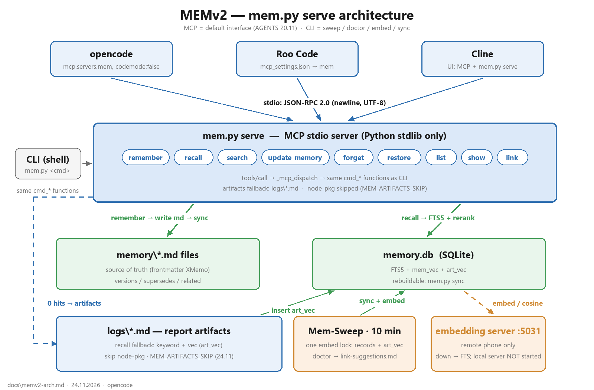
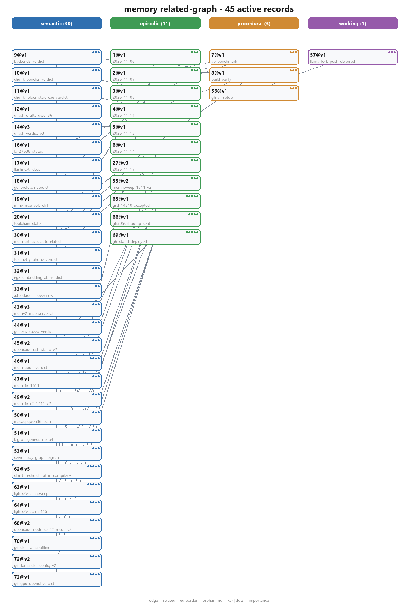

# MEM — локальная память для проектов и ИИ-агентов (XMemo-шаблон)

Портативный модуль: скопируйте папку `MEM\` в корень любого проекта — и агент
(Cline, OpenCode, Cursor, Claude Code, ...) получает долговременную память.
Ничего не устанавливается: только Python 3.10+ (стандартная библиотека, 0 зависимостей).

 

_Схема: MCP-сервер `mem.py serve` + CLI. Граф: связи активных записей памяти
(рендер `docs/render-memv2.py` / `docs/render-memgraph.py`)._

```
<project>\
  MEM\
    mem.py          # CLI: все операции памятью
    memory\         # данные (создаётся при первом запуске любой команды,
                    #  открывающей БД)
      *.md          # ИСТОЧНИК ИСТИНЫ - frontmatter XMemo
      MEMORY.md     # генерируемый индекс (не править руками)
      memory.db     # поисковый индекс SQLite+FTS5 (пересобираемый)
      memory.db-wal # служебный WAL
    README.md
    DESIGN.md       # контракт модели (типы, версии, бюджеты)
```

## Старт (одна команда)

```powershell
cd <project>\MEM
python mem.py sync     # построить memory.db + MEMORY.md из memory\*.md
python mem.py recall "запрос"   # поиск
```

## Команды

| Команда | Что делает |
|---|---|
| `recall "запрос" [--limit 10] [--max-bytes 6000] [--type semantic] [--path memory/semantic] [--json] [--no-vector] [--no-artifacts]` | поиск: bm25 + recency + importance (+ cosine, если настроен embedding-сервер); только active; бюджет тела выдачи 6000 B (`--max-bytes`); цитата `id@vN`; `--path` — фильтр по префиксу namespace; `--json` — машиночитаемый вывод (**кроме 0 хитов**: там обычный `recall: 0 hits` + артефакты); `--no-vector` — чистый FTS5 **без единого сетевого вызова** (в т.ч. без доливки векторов); при 0/мало хитов — догон keyword-поиском по `logs\**\*.md` (рекурсивно; отчёты-артефакты, отключение: `--no-artifacts` / `MEM_ARTIFACTS=0`, свой каталог: `MEM_ARTIFACTS_DIR`) |
| `remember "текст" [--file путь] --type semantic --path memory/semantic/x [--name stem] [--importance 3] [--author opencode] [--related 12,15] [--no-auto-related]` | новая запись (авто-sync + авто-эмбеддинг); если `--related` не задан — авто-связи: cosine top-3 по вектору новой записи (`MEM_RELATED_TOP`, порог `MEM_RELATED_MIN=0.55`, off: `MEM_RELATED=0`), печать `related auto: ...`; **авто-связи работают только если remote жив в момент remember** (нет вектора → нет cosine-кандидатов); авто-связи пишутся в тот же файл **без новой версии**. **`--file`** (или `-` = stdin) — текст из UTF-8 файла вместо аргумента: обходит кавычки/`$`/backtick в PowerShell-inline; ровно один источник (текст ИЛИ `--file`) |
| `update <id\|файл> "новый текст" [--file путь] [--importance N] [--related 12,15]` | новая версия: старая -> superseded, новая active (НЕ перезапись); без `--related` связи переносятся сами; `--file` — как у remember |
| `forget <id\|файл>` / `restore <id>` | tombstone / возврат (удаление обратимо) |
| `list [--status active\|superseded\|deleted] [--type episodic]` | список записей; **без `--status` — ВСЕ статусы**, включая `deleted` |
| `show <id\|файл>` | одна запись целиком |
| `link <id\|файл> [12 15] [--off]` | связи записи: без ids — показ (исходящие `->` + входящие `<-`); с ids — добавить/снять у СУЩЕСТВУЮЩЕЙ записи без новой версии (правит только `related`); alias `links` |
| `sync` | пересобрать БД из md (md = source of truth; БД всегда восстановима); **portable ids**: штампует `id: N` во frontmatter каждой записи — id и `related` переживают полную пересборку БД (WARNING только для легаси-файлов без `id:`; конфликт чужого id → переназначение + предупреждение) |
| `embed [--force]` | наполнить вектора (нужен embedding-сервер) |
| `index` | перегенерировать MEMORY.md (sync делает это уже сам) |
| `serve` | MCP stdio-сервер (MEMv2): инструменты памяти для агентов — `remember/recall/search/update_memory/forget/restore/list/show/link`; корень проекта определяется иначе, чем у CLI (см. «Встраивание в любой проект») |

recall/list/show/link (и alias `links`) **сами** пересинхронизируют БД, если md
менялись руками: правки md новее БД, ручные удаления md (строки без файла) и
первый запуск (пустая БД + существующие md). Ручной `sync` — принудительная
полная пересборка.

## Правила для агента (вставить в AGENTS.md проекта)

```markdown
## Память (MEM\, шаблон XMemo, инструмент mem.py)
- Когда звать recall — три триггера: (1) старт задачи; (2) поворот/развилка;
  (3) неожиданная находка/вывод/открытие — сначала поиск («встречалось ли?»,
  «нет ли уже записи?»), потом запись: не плодит дубли и находит связи.
  Не после каждого шага — контекст сессии держит всё сам:
  `python MEM\mem.py recall "ключевые слова"` — гибридный поиск
  (bm25+recency+importance+cosine; при недоступности remote молча FTS — смотреть mode:).
- Записывать/обновлять/удалять ТОЛЬКО через remember/update/forget — не править md
  руками (текст подтягивается при следующем recall/sync; вектор доливается, если
  запись новая или изменилось frontmatter `updated` — правка **тела** оставляет
  старый вектор, тогда `embed --force`).
- Инлайн-кавычки ломают PowerShell — «гадкий» текст (`"`/`'`/`$`/backtick,
  многострочный, длиннее ~2 строк) всегда через файл: данные → `write` + `--file`,
  логика → скрипт `.ps1`/`.py` запуском короткой командой; инлайном — только
  короткие однозначные команды. Работает для любых инструментов, не только mem.py.
- Цитаты из recall (`12@v1`) копируются в update/forget/restore/show как есть.
- Связи: у нового вердикта/бага/исследования `--related 12,15` («bug → fix guide»,
  «вердикт → исследование»); к уже существующей записи — `mem.py link <id> 12,15`
  (без новой версии). Смотреть: `mem.py link <id>` (без ids = показ), в recall — строка
  `[related -> 12]` под записью. Связи переживают update (новая версия наследует).
- Типы: semantic (долгие факты/вердикты), episodic (что произошло), procedural (как делать),
  working, identity. Писать решения с обоснованием, замеры с условиями, вердикты
  «так не делать». НЕ писать: ход промежуточных шагов, сырой лог, одноразовые команды.
- Обновление вердикта = `update` (новая версия, старая -> superseded), перезапись запрещена.
- Память ссылается на артефакты (логи/отчёты), не копирует их.
- Перед записью - recall: нет ли уже записи на эту тему (дубликатов не плодить).
```

## Embeddings (опционально, гибридный поиск)

Без сервера всё работает (FTS5: keywords). С сервером recall понимает смысл запросов
(синонимы, формулировки без точных слов). Каскад (решение 15.11): **remote-сервер →
FTS**. mem.py **никогда не стартует сервер сам**: если remote недоступен, recall
молча деградирует в FTS (`fts (remote server down)`), embed — честно defer'ит
(rc=1) и доложится при следующем запуске. Ручной локальный fallback существует —
`SERVER\embed-server.bat` (только по явному «да», см. `SERVER\README.md`).

```powershell
# default: дистанционный сервер (например, телефон через `adb forward tcp:5031 tcp:5131`)
# включён по умолчанию с 15.11; таймаут embed: floor 60 с (MEM_EMBED_TIMEOUT),
# растёт с размером батча, cap = max(600 с, MEM_EMBED_TIMEOUT) (CPU-предфилл удалённого сервера).
$env:MEM_EMBED_REMOTE = "0"     # выключить vector-часть совсем (чистый FTS, без сети)
$env:MEM_EMBED_URL  = "http://127.0.0.1:5031/v1/embeddings"  # если адрес другой
$env:MEM_EMBED_MODEL = "YourModel-Alias"            # если alias другой
$env:MEM_ROOT       = "D:\my-project"  # явный корень (иначе определяется сам: см. ниже)
python mem.py embed       # наполнить вектора (дальше кэш в memory.db)
python mem.py recall "..."   # гибрид: bm25 0.45 + recency 0.20 + imp 0.10 + cosine 0.25
                             # (без векторов: 0.60 / 0.25 / 0.15)
```

### Встраивание в любой проект

Один файл `mem.py` работает в двух раскладках без правок:

- **портативная**: положить папку `MEM\` в проект (`<project>\MEM\mem.py`) —
  данные в `<project>\MEM\memory\`;
- **инструментальная**: положить в `<project>\tools\mem.py` — данные в
  `<project>\memory\` (корень = родитель tools/bin/scripts).

Порядок определения ROOT у CLI: `MEM_ROOT` env → папка `MEM` → родитель для
`tools\|bin\|scripts\` (**победа над случайным `tools\memory\`**) → наличие
рядом `memory\` → папка скрипта.

У `serve` (MCP) корень определяется **иначе**: `MEM_ROOT` env → вверх от
**рабочего каталога клиента** до ближайшего маркера: сильные (`.git`,
`AGENTS.md`, `opencode.json(c)`, `.opencode`), `memory\` — только если в нём
уже есть `MEMORY.md`/`memory.db`; если маркеров нет нигде — сам cwd (вверх по
дереву до маркеров выше по иерархии тоже доходит); на локацию скрипта никогда
не падает — один mem.py обслуживает разные проекты изолированно.

- `recall`/`embed` ходят в remote и ничего не стартуют локально. Записи
  (remember/update/forget/restore) тоже опрашивают remote: health-проба 3 с,
  и если сервер жив — вектор доливается сразу; если нет — молча пропускается
  и догоняется при следующем recall/embed.
- Remote недоступен → recall молча FTS5 (`fts (remote server down)`), embed — defer
  с rc=1. `MEM_EMBED_REMOTE=0` — вектора выключены совсем (FTS всегда, без сети).
- Вектора кэшируются в memory.db: сервер нужен только для эмбеддинга запроса
  (1 вызов на recall) и доливки новых записей.
- авто-эмбеддинг включён в remember/update/forget/restore, но авто-связи
  (related auto) считаются только когда remote жив в момент remember.

**Запуск/настройка сервера: `SERVER\`** (README, форварды, health-проба, embed-server.bat).

## Бэкап (опционально, все проекты разом)

Скрипт бэкапа **не входит в модуль** (нужен adb/устройство) — это отдельный
инструмент хост-проекта: `tools\mem-backup.ps1` (реестр корней рядом —
`tools\mem-backup-roots.txt`; запуск раз в сутки — гейт в Phone-Embed-Watchdog,
см. AGENTS.md хоста). Идея (для переноса на свой хост):

- находит все каталоги `memory\` с `*.md` под корнями из файла-реестра
  (корни/исключения/глубина — там же) — **новый проект под корнем бэкапится сам**;
- пакует **все проекты в один** датированный tar.gz + `MANIFEST.tsv`
  (id → исходный путь), кладёт в `/sdcard/mem-backup/` (или куда угодно),
  байтовая сверка после push, ротация — хранит 3 последних архива;
- копирует все `*.md` (в архив идут и производные, включая `MEMORY.md`) **плюс
  `memory.db` согласованной копией** (SQLite backup API — безопасно при WAL;
  в манифесте отдельная колонка `dbbytes`, restore сверяет размер и при
  расхождении честно warning'ит) — restore сохраняет нумерацию id (связи
  `related` не сдвигаются) и кэш векторов, без пере-эмбеда;
- запуск раз в сутки — из watchdog/gate-скрипта; вручную — когда захочется;
- restore: последний архив или путь к tar.gz → в песочницу или на место
  (`-Force` — с отодвиганием старого); после боевого restore сам делает
  `mem.py sync` по манифесту (в песочницу `-RestoreRoot` — без sync).

## Гарантии

- md — источник истины; `memory.db` удаляется и пересобирается без потери
  контента (`sync`), но кэш векторов (`mem_vec`) при этом теряется и догоняется
  командой `embed` при живом remote. **Оговорка (16.11):** id назначаются по
  отсортированному порядку файлов, поэтому после ПОЛНОЙ пересборки «голые»
  числа в `related: 1,4` могут указывать уже на другие записи (сам mem.py
  предупреждает `WARNING full rebuild renumbers ids`); цитаты `id@vN` из
  вывода при этом становятся `[missing]`, ничего не крашится.
- `MEMORY.md` генерируется, руками не править.
- Удаление обратимо (`forget` -> `restore`); версии неизменяемы (`update` -> supersedes).
- Работает офлайн; embedding-сервер — улучшение, а не зависимость.

## Auto-update (propagate)

This repo is the **single source of truth** for `mem.py`; consumers keep a
plain copy at their own path and never see git.

- `propagate.txt` — one destination `mem.py` path per line (`#` = comment);
  a new consumer project = one line.
- `mem-propagate.ps1` — copies this repo's `mem.py` to every target and
  verifies sha256. `-Check` reports drift only (exit 1, touches nothing).
  Log: `mem-propagate.log` (gitignored).
- `mem-update.ps1` — scheduled wrapper (Windows task, daily): `git pull`
  **only when the working tree is clean** (dirty tree → SKIP, uncommitted
  edits are never overwritten), ff-only, then propagates. Only what was
  pushed here reaches consumers; rollback = `git revert` + next tick.

## License

MIT — см. [LICENSE](LICENSE).
